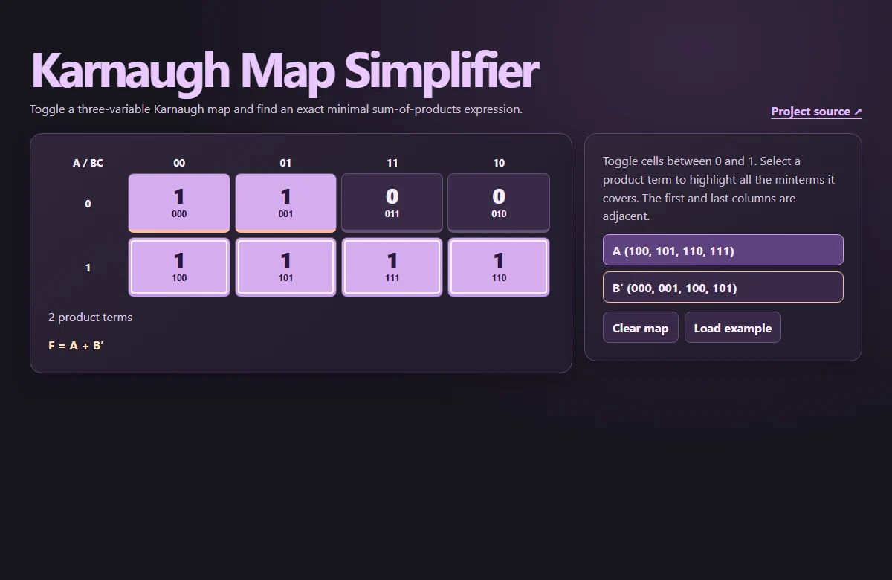

# Karnaugh Map Simplifier

Toggle a three-variable Karnaugh map and find an exact minimal sum-of-products expression.

[Open the browser app](https://surfingcoder.com/apps/karnaugh-map-simplifier/)

## Run locally

Run the following command in this repository and open [localhost:8000](http://localhost:8000).

    python -m http.server 8000

The solver enumerates implicants that cover only active minterms. It minimizes the number of product terms, then literal count, and resolves ties consistently. An apostrophe indicates a complemented variable.

## Verify

Run the following command with Node.js 22 or newer.

    node --test
